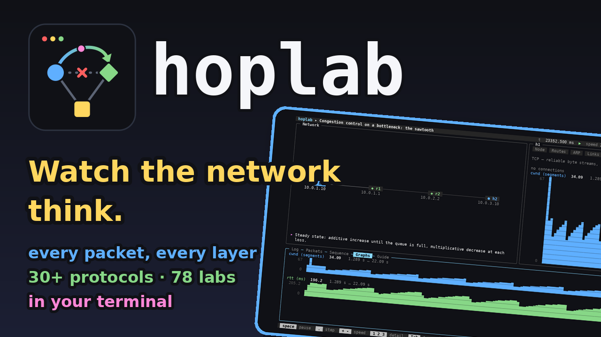
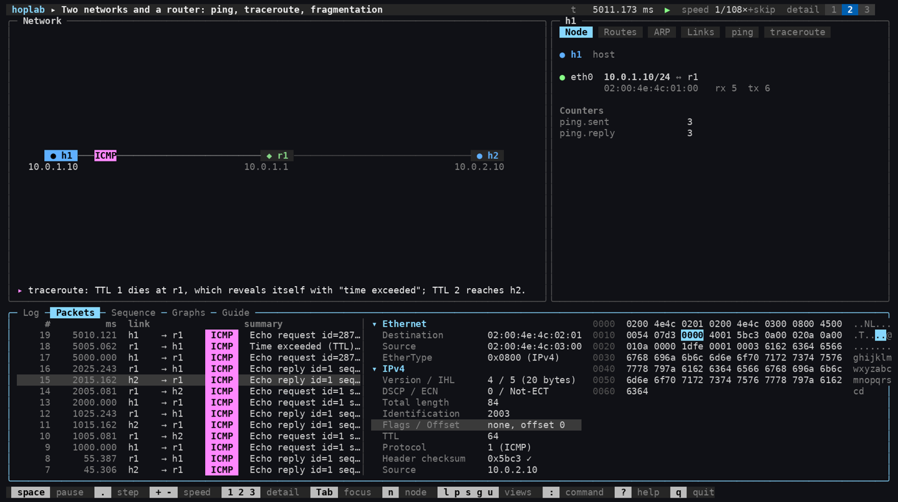
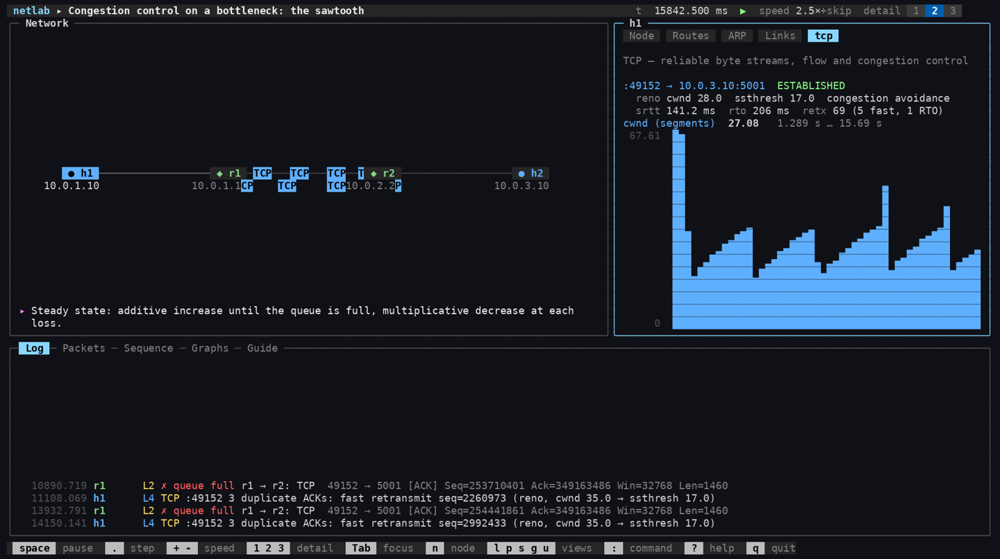
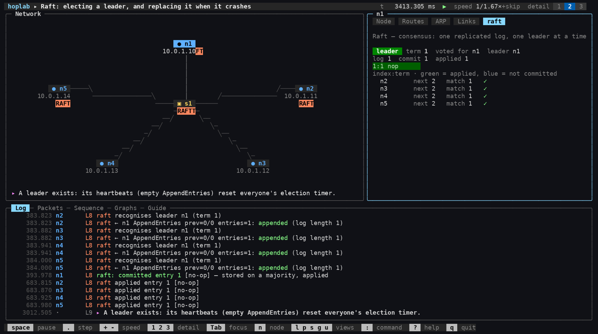
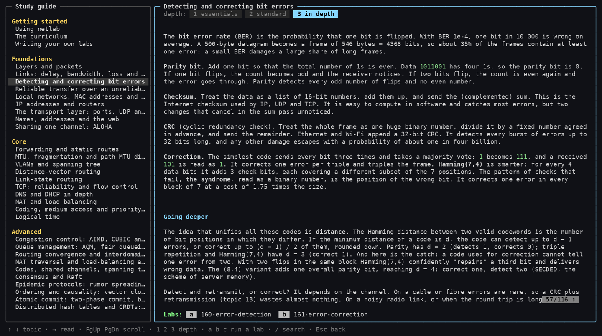
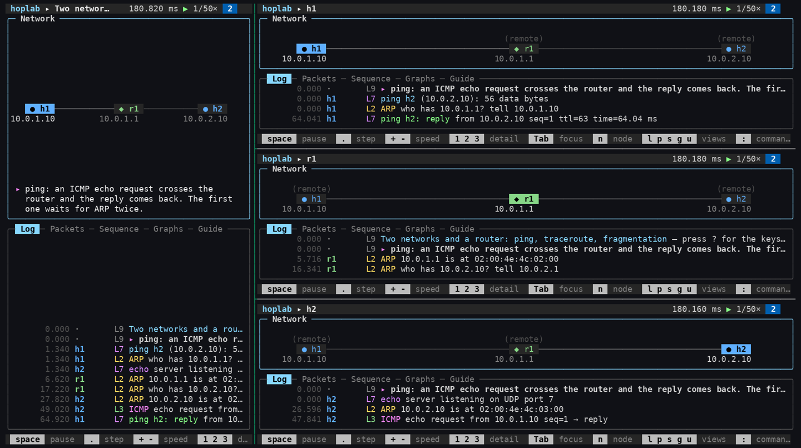

<p align="center">
  
</p>

<h1 align="center">hoplab</h1>

<p align="center">
  <b>Un laboratorio di reti nel terminale.</b><br>
  Ogni pacchetto, ogni livello, ogni protocollo — dal primo ping agli algoritmi di consenso.
</p>

<p align="center">
  <a href="README.md">English</a> ·
  <a href="#avvio-rapido">Avvio rapido</a> ·
  <a href="#che-cosa-contiene">Che cosa contiene</a> ·
  <a href="#la-guida-di-studio">Guida di studio</a> ·
  <a href="docs/">Documentazione</a>
</p>

<p align="center">
  
</p>

<p align="center">
  <a href="https://www.youtube.com/watch?v=bQqE4w2FR7c">
    
  </a><br>
  <sub>▶ Dimostrazione di un minuto su YouTube (in inglese, con la sua colonna sonora, <i>Round Trip</i>, sintetizzata da <code>tools/media/music.py</code>)</sub>
</p>

hoplab emula una rete dentro un solo programma: host, router e switch si
scambiano **frame reali, esatti al byte** (Ethernet, ARP, IPv4, ICMP, UDP, TCP,
DNS, …) su collegamenti con larghezza di banda, ritardo, perdita, errori sui
bit e code. Si guardano i pacchetti attraversare la mappa, si apre ciascuno
fino ai byte, si leggono le tabelle di ogni nodo, si tracciano i grafici di ciò
che i protocolli misurano, si rompe qualcosa e si osserva che cosa succede. Un
catalogo di 78 laboratori e una guida di studio accompagnano da «che cos'è un
frame?» fino ai dirottamenti BGP, a CoDel, a Raft sotto partizione e ai CRDT.

È scritto in C11 senza dipendenze, funziona in qualsiasi terminale, parla
inglese e italiano, e lo stesso laboratorio può girare in una finestra, in
finestre affiancate come processi separati, oppure su più macchine.

## Avvio rapido

```sh
make            # compila ./hoplab e le demo classiche (serve solo un compilatore C)
./hoplab        # menu: catalogo, guida di studio, creazione guidata di topologie
```

oppure direttamente un laboratorio:

```sh
./hoplab list                          # il catalogo
./hoplab run 101-ping                  # esegue un laboratorio in questa finestra
./hoplab run 320-tcp-congestion cc=cubic   # i laboratori hanno parametri
./hoplab guide                         # la guida di studio
make test                              # tutti i laboratori, senza interfaccia, con le verifiche
make regress                           # la suite di regressione completa (tests/)
```

Dentro un laboratorio: `spazio` mette in pausa, `.` avanza di un passo, `+`/`-`
cambiano la velocità, `1 2 3` scelgono il livello di dettaglio, `n` seleziona
il nodo successivo, `l p s g u` cambiano la vista in basso (registro,
pacchetti, diagramma di sequenza, grafici, guida), `:` apre una riga di
comando (`h1 ping h2`, `link r1 r2 down`, `link h1 r1 loss=0.3`,
`node n3 down`), `?` elenca tutti i tasti.

L'interfaccia è in italiano se il sistema è in italiano; altrimenti
`HOPLAB_LANG=it ./hoplab` oppure `./hoplab --lang it`.

<p align="center">
  
  
  
  
</p>

## Che cosa contiene

| Livello | Protocolli, meccanismi e strumenti |
|---|---|
| Fisico / collegamento | collegamenti con larghezza di banda, ritardo di propagazione, jitter, perdita (indipendente o a raffiche), tasso di errore sui bit, duplicazione, riordino, MTU, code · codici di linea: parità, checksum di Internet, CRC-8/16/32, ripetizione, Hamming(7,4), SECDED, Hamming con interleaving, Reed–Solomon(255,223) · un banco di prova dei codici · laboratorio di accesso al mezzo: ALOHA, slotted ALOHA, CSMA, CSMA/CD, CSMA/CA con terminali nascosti e RTS/CTS |
| Collegamento | Ethernet, ARP, switch che apprendono, VLAN 802.1Q e trunk, spanning tree e rapid spanning tree |
| Rete | inoltro IPv4 e IPv6 (Neighbor Discovery, SLAAC, ICMPv6, path MTU) con longest prefix match, TTL, frammentazione e riassemblaggio, ICMP, `ping`, `traceroute` · instradamento: statico, RIP e RIPng, OSPF e OSPFv3 (link state), BGP con estensioni multiprotocollo (path vector, politiche, validazione dell'origine) · NAT (quattro comportamenti, port forwarding, hole punching) · discipline di coda: drop-tail, RED, CoDel, PIE, fair queueing, priorità stretta, token bucket · ECN |
| Trasporto | UDP · TCP (handshake, finestra scorrevole, RTO, fast retransmit, controllo di flusso, SACK, ACK ritardati, path MTU discovery, Tahoe / Reno / NewReno / CUBIC / BBR v1, ECN; su IPv4 e IPv6) · bilanciatore di carico di livello 4 (round robin, pesato, least connections, hash, consistent hashing, Maglev, power of two choices, controlli di salute) |
| Applicazione | DNS (A e AAAA, autoritativo, resolver ricorsivo con cache, `dig`, laboratorio di cache poisoning) · DHCP e DHCPv6 · HTTP/1.1 · generatori e ricevitori di traffico |
| Sistemi distribuiti | Raft · gossip e rilevazione dei guasti SWIM · orologi di Lamport e vettoriali, broadcast causale e totalmente ordinato · commit a due e tre fasi · DHT Chord · CRDT |

Tutto gira su un tempo virtuale guidato da una coda di eventi: un'esecuzione è
riproducibile a partire dal suo seme, si può mettere in pausa e far avanzare
passo passo, e i tempi morti vengono saltati. `./hoplab modules` elenca tutti i
moduli; `./hoplab help NOME` ne spiega uno, compreso ciò che semplifica
rispetto al protocollo reale.

### Il catalogo

78 laboratori su quattro livelli — **Rudimenti** (primo contatto),
**Fondamenti** (un corso di laurea triennale), **Avanzato** (magistrale),
**Frontiera** (taglio di ricerca). Ogni laboratorio è un piccolo file di testo con una
descrizione, parametri regolabili, una cronologia commentata e attese che
`hoplab check` verifica:

```
title      A routing loop, and the TTL that saves the network
title[it]  Un ciclo di instradamento, e il TTL che salva la rete
level  2
param  ttl 16 Initial TTL of the ping
node h1 host
node r1 router
node r2 router
link h1 r1 delay=2ms
link r1 r2 delay=8ms
...
run h1 ping 10.9.1.1 count=1 ttl=$ttl
note[it] 0  Il pacchetto rimbalza fra r1 e r2, perdendo un'unità di TTL a ogni salto...
expect h1 ping.error == 1
```

Se ne scrivono di propri con un editor qualsiasi, oppure si lascia che la
creazione guidata del menu ne costruisca uno (topologia, collegamenti,
instradamento, traffico). Il linguaggio è documentato in
[docs/scenario-format.md](docs/scenario-format.md) (in inglese).

### Tre modi di eseguire un laboratorio

| | Comando | Che cosa succede |
|---|---|---|
| Una finestra | `hoplab run LAB` | ogni nodo è simulato in questo processo; si può mettere in pausa, avanzare a passi e cambiare velocità |
| Finestre affiancate | `hoplab windows LAB` | un pannello per nodo più la vista dell'intera rete (kitty o tmux); ogni pannello è un processo separato e i collegamenti fra loro sono tunnel UDP su 127.0.0.1 |
| Più macchine | `hoplab node LAB NODO` su ogni macchina, `hoplab monitor LAB` su una | gli stessi tunnel attraverso una rete vera: si scrive nello scenario l'indirizzo di ogni macchina (`place r1 192.168.1.20`), o lo fa il menu; `hoplab plan LAB` stampa i comandi |

Vedi [docs/distributed.md](docs/distributed.md).

<p align="center">
  
</p>

## La guida di studio

`./hoplab guide` (o il menu) apre un programma di studio organizzato per
livello e per argomento. Ogni argomento si legge a tre profondità —
l'essenziale, standard, approfondito — elenca i laboratori che lo mostrano e li
avvia con un tasto. Gli stessi file sono semplice Markdown in
[`guide/it`](guide/it) e [`guide/en`](guide/en).

| Percorso | Per chi | Argomenti |
|---|---|---|
| Per iniziare | tutti | usare hoplab, il programma di studio, scrivere i propri laboratori |
| Rudimenti | primo contatto | livelli e pacchetti, collegamenti, rilevazione degli errori, trasferimento affidabile, LAN e switch, IP e router, trasporto, DNS/DHCP/HTTP, condivisione di un canale |
| Fondamenti | laurea triennale | inoltro e rotte statiche, MTU e frammentazione, VLAN e spanning tree, instradamento distance vector e link state, affidabilità e controllo di flusso di TCP, DNS e DHCP in dettaglio, NAT e bilanciamento del carico, codici e accesso al mezzo, tempo logico |
| Avanzato | laurea magistrale | controllo di congestione, gestione delle code, convergenza e instradamento inter-dominio, attraversamento dei NAT e algoritmi di bilanciamento, codici e canali, Raft, protocolli epidemici, ordinamento e causalità, commit atomico, DHT e CRDT |
| Frontiera | dottorato e ricerca | equità e controllo di congestione basato su modelli, politiche e sicurezza di BGP, sicurezza del DNS, hashing su larga scala, accesso al mezzo wireless, consenso sotto partizione, appartenenza e churn, fare ricerca con hoplab |

## Da dove è partito: trasferimento affidabile su UDP

Il repository è nato come tre programmi — stop-and-wait, Go-Back-N e Selective
Repeat — che spostano un testo fra due processi **reali** su veri socket UDP,
attraverso un canale che perde e corrompe pacchetti di proposito, con
un'interfaccia che mostra i pacchetti in volo, le regole del protocollo
applicate e le finestre scorrevoli. Sono ancora qui, raggiungibili dal menu o
direttamente:

```sh
./demo.sh            # stop-and-wait, sender e receiver affiancati
./demo.sh gbn -w 4   # Go-Back-N
./demo.sh sr         # Selective Repeat
```

[docs/reliable-transfer.md](docs/reliable-transfer.md) descrive i protocolli e
tutte le opzioni.

## Lingue

Il testo è in inglese nel sorgente e tradotto con normali cataloghi PO
(`locale/<lingua>/`, uno per modulo; i file degli scenari e la guida portano
le proprie traduzioni). L'italiano è completo. La lingua segue `HOPLAB_LANG`,
`LC_ALL`, `LANG`, oppure `--lang it`. Per aggiungerne una, vedi
[locale/README.md](locale/README.md).

## Struttura del repository

```
src/            hoplab: nucleo (eventi, collegamenti, stack, scenari, interfaccia) e un file per protocollo
scenarios/      il catalogo (*.nl)
guide/en, it/   la guida di studio (Markdown)
locale/         cataloghi dei messaggi (PO) e il modello hoplab.pot
docs/           linguaggio degli scenari, scrittura di moduli, esecuzione distribuita, demo classiche
tests/          suite di regressione e varianti dei parametri
tools/          estrazione delle stringhe, compilazione di un solo modulo, produzione di immagini e video
media/          logo, schermate, anteprima, video, colonna sonora
*.c *.h demo.sh le demo classiche di trasferimento affidabile e la libreria per il terminale
```

## Estenderlo

Un protocollo è un file C in `src/` che si registra da solo; non occorre
modificare altro. Ha a disposizione timer, gestori UDP/TCP/IP/Ethernet, rotte,
agganci sui pacchetti, analizzatori, contatori, grafici e un pannello
nell'interfaccia. [docs/writing-modules.md](docs/writing-modules.md) mostra un
esempio completo.

## Requisiti e limiti

- Linux (usa `/proc/self/exe`, `poll`, un terminale UTF-8 a 256 colori), un
  compilatore C11 e `make`. `tmux` o `kitty` per le finestre affiancate.
  Python 3, Pillow, numpy e ffmpeg solo per rigenerare immagini e video.
- È un emulatore didattico, non un simulatore di prestazioni: al massimo 64
  nodi e 160 collegamenti per laboratorio, e alcuni protocolli sono volutamente
  ridotti (l'aiuto di ogni modulo dice come: per esempio BGP è solo eBGP con un
  router per AS, OSPF ha una sola area e nessun designated router, TCP non ha
  i timestamp). I frame sono veri, i cavi no: nulla tocca la rete reale
  tranne i tunnel UDP delle modalità a più processi.
</content>

## Licenza

Apache License 2.0: vedi [LICENSE](LICENSE) e [NOTICE](NOTICE). Le note di
rilascio sono in [CHANGELOG.md](CHANGELOG.md).
