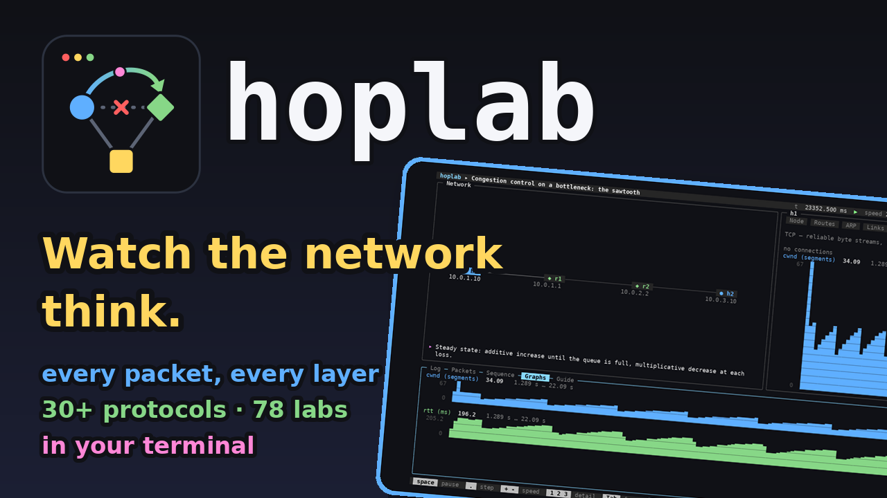
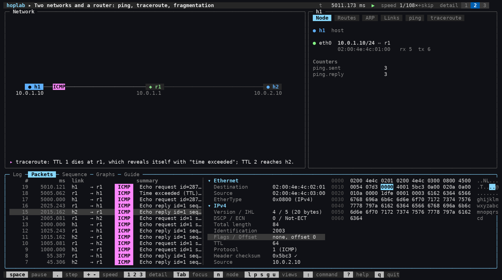
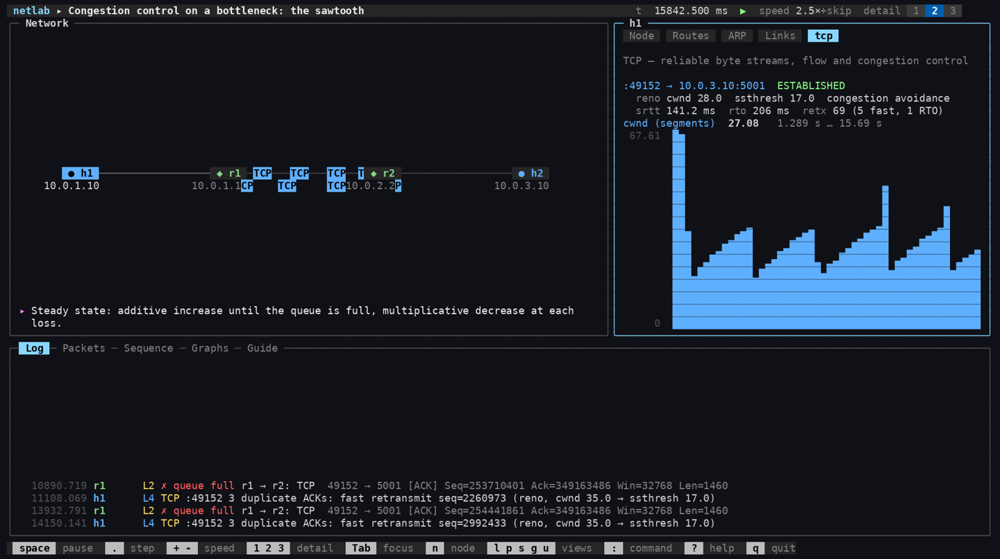
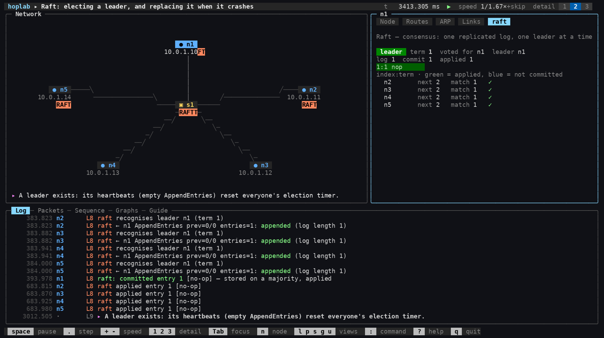
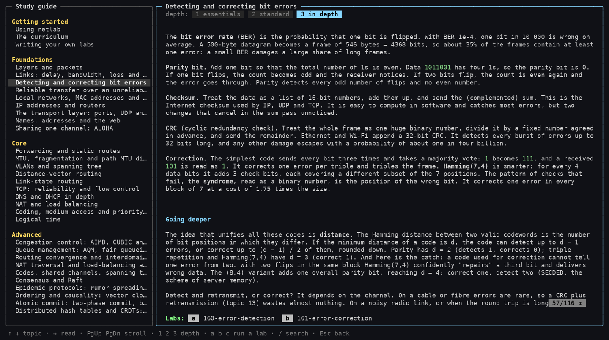
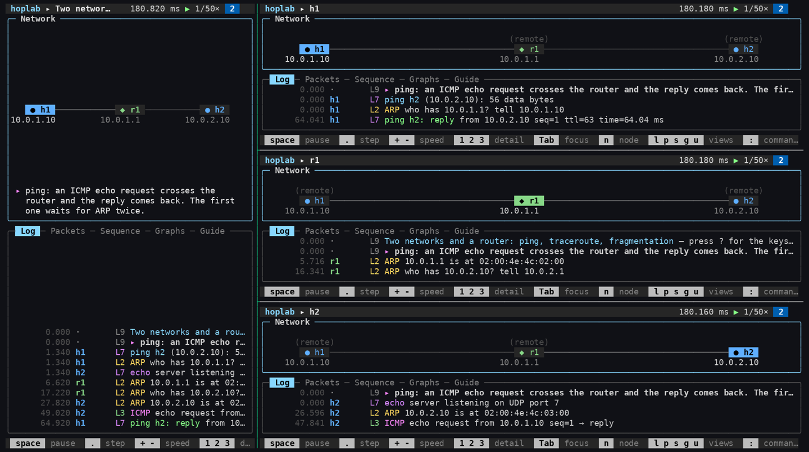

<p align="center">
  
</p>

<h1 align="center">hoplab</h1>

<p align="center">
  <b>A network laboratory in your terminal.</b><br>
  Every packet, every layer, every protocol — from the first ping to consensus algorithms.
</p>

<p align="center">
  <a href="README.it.md">Italiano</a> ·
  <a href="#quick-start">Quick start</a> ·
  <a href="#whats-inside">What's inside</a> ·
  <a href="#the-study-guide">Study guide</a> ·
  <a href="docs/">Docs</a>
</p>

<p align="center">
  
</p>

<!-- VIDEO: upload media/hoplab-demo.mp4 to YouTube (title, description and tags are in
     docs/video.md), then replace the href below with the YouTube URL. -->
<p align="center">
  <a href="media/hoplab-demo.mp4">
    
  </a><br>
  <sub>▶ One-minute demo (with its own soundtrack, <i>Round Trip</i>, synthesised by <code>tools/media/music.py</code>)</sub>
</p>

hoplab emulates a network inside one program: hosts, routers and switches
exchange **real, byte-exact frames** (Ethernet, ARP, IPv4, ICMP, UDP, TCP, DNS,
…) over links with bandwidth, delay, loss, bit errors and queues. You watch the
packets cross the map, open any of them down to the bytes, read each node's
tables, plot what the protocols measure, break things, and see what happens.
A catalog of 78 labs and a study guide take you from "what is a frame?" to
BGP hijacks, CoDel, Raft under partitions and CRDTs.

It is written in C11 with no dependencies, runs in any terminal, speaks
English and Italian, and the same lab can run in one window, in tiled windows
as separate processes, or across several machines.

## Quick start

```sh
make            # builds ./hoplab and the classic demos (needs only a C compiler)
./hoplab        # menu: catalog, study guide, topology wizard
```

or go straight to a lab:

```sh
./hoplab list                          # the catalog
./hoplab run 101-ping                  # run a lab in this window
./hoplab run 320-tcp-congestion cc=cubic   # labs have parameters
./hoplab guide                         # the study guide
make test                              # every lab, headless, with its checks
make regress                           # the full regression suite (tests/)
```

Inside a lab: `space` pauses, `.` steps, `+`/`-` change speed, `1 2 3` choose
how much detail you see, `n` selects the next node, `l p s g u` switch the
bottom view (log, packets, sequence diagram, graphs, guide), `:` opens a
command line (`h1 ping h2`, `link r1 r2 down`, `link h1 r1 loss=0.3`,
`node n3 down`), `?` lists every key.

<p align="center">
  
  
  
  
</p>

## What's inside

| Layer | Protocols, mechanisms and tools |
|---|---|
| Physical / link | links with bandwidth, propagation delay, jitter, loss (independent or in bursts), bit error rate, duplication, reordering, MTU, queues · link codes: parity, Internet checksum, CRC-8/16/32, repetition, Hamming(7,4), SECDED, interleaved Hamming, Reed–Solomon(255,223) · a coding bench · medium access lab: ALOHA, slotted ALOHA, CSMA, CSMA/CD, CSMA/CA with hidden terminals and RTS/CTS |
| Link | Ethernet, ARP, learning switches, 802.1Q VLANs and trunks, spanning tree and rapid spanning tree |
| Network | IPv4 and IPv6 (Neighbor Discovery, SLAAC, ICMPv6, path MTU) forwarding with longest prefix match, TTL, fragmentation and reassembly, ICMP, `ping`, `traceroute` · routing: static, RIP and RIPng, OSPF and OSPFv3 (link state), BGP with multiprotocol extensions (path vector, policies, origin validation) · NAT (four behaviours, port forwarding, hole punching) · queue disciplines: drop-tail, RED, CoDel, PIE, fair queueing, strict priority, token bucket · ECN |
| Transport | UDP · TCP (handshake, sliding window, RTO, fast retransmit, flow control, SACK, delayed ACKs, path MTU discovery, Tahoe / Reno / NewReno / CUBIC / BBR v1, ECN; over IPv4 and IPv6) · layer-4 load balancer (round robin, weighted, least connections, hashing, consistent hashing, Maglev, power of two choices, health checks) |
| Application | DNS (A and AAAA, authoritative, recursive resolver with cache, `dig`, cache-poisoning lab) · DHCP and DHCPv6 · HTTP/1.1 · traffic generators and sinks |
| Distributed systems | Raft · gossip and SWIM failure detection · Lamport and vector clocks, causal and total order broadcast · two- and three-phase commit · Chord DHT · CRDTs |

Everything runs on virtual time driven by an event queue, so a run is
reproducible from its seed, can be paused and stepped, and idle time is
skipped. `./hoplab modules` lists every module; `./hoplab help NAME` explains
one, including what it simplifies with respect to the real protocol.

### The catalog

78 labs in four levels — **Foundations** (first contact), **Core** (an
undergraduate course), **Advanced** (graduate), **Frontier** (research
flavoured). Each lab is a small text file with a description, tunable
parameters, a narrated timeline and expectations that `hoplab check` verifies:

```
title  A routing loop, and the TTL that saves the network
level  2
param  ttl 16 Initial TTL of the ping
node h1 host
node r1 router
node r2 router
link h1 r1 delay=2ms
link r1 r2 delay=8ms
...
run h1 ping 10.9.1.1 count=1 ttl=$ttl
note 0  The packet bounces between r1 and r2, losing one TTL unit per hop...
expect h1 ping.error == 1
```

Write your own with any editor, or let the wizard in the menu build one
(topology, links, routing, traffic). The language is documented in
[docs/scenario-format.md](docs/scenario-format.md).

### Three ways to run a lab

| | Command | What happens |
|---|---|---|
| One window | `hoplab run LAB` | every node is simulated in this process; you can pause, step and change speed |
| Tiled windows | `hoplab windows LAB` | one pane per node plus the whole-network view (kitty or tmux); each pane is a separate process and the links between them are UDP tunnels on 127.0.0.1 |
| Several machines | `hoplab node LAB NODE` on each machine, `hoplab monitor LAB` on one | the same tunnels across a real network: put the address of each machine in the scenario (`place r1 192.168.1.20`), or let the menu write it; `hoplab plan LAB` prints the commands |

See [docs/distributed.md](docs/distributed.md).

<p align="center">
  
</p>

## The study guide

`./hoplab guide` (or the menu) opens a curriculum organised by level and topic.
Every topic can be read at three depths — essentials, standard, in depth —
lists the labs that show it, and starts them with one key. The same files are
plain Markdown in [`guide/en`](guide/en) and [`guide/it`](guide/it).

| Track | For | Topics |
|---|---|---|
| Getting started | everybody | using hoplab, the curriculum, writing your own labs |
| Foundations | first contact | layers and packets, links, error detection, reliable transfer, LANs and switches, IP and routers, transport, DNS/DHCP/HTTP, sharing a channel |
| Core | an undergraduate course | forwarding and static routes, MTU and fragmentation, VLANs and spanning tree, distance-vector and link-state routing, TCP reliability and flow control, DNS and DHCP in depth, NAT and load balancing, coding and medium access, logical time |
| Advanced | graduate | congestion control, queue management, convergence and inter-domain routing, NAT traversal and balancing algorithms, codes and channels, Raft, epidemic protocols, ordering and causality, atomic commit, DHTs and CRDTs |
| Frontier | research | fairness and model-based congestion control, BGP policy and security, DNS security, hashing for scale, wireless medium access, consensus under partitions, membership and churn, doing research with hoplab |

## Where it started: reliable transfer over UDP

The repository began as three programs — stop-and-wait, Go-Back-N and
Selective Repeat — that move a text between two **real** processes over real
UDP sockets through a channel that loses and corrupts packets on purpose, with
an interface showing packets in flight, the protocol rules being applied and
the sliding windows. They are still here, reachable from the menu or directly:

```sh
./demo.sh            # stop-and-wait, sender and receiver side by side
./demo.sh gbn -w 4   # Go-Back-N
./demo.sh sr         # Selective Repeat
```

[docs/reliable-transfer.md](docs/reliable-transfer.md) describes the protocols
and every option.

## Languages

Text is English in the source and translated through standard PO catalogs
(`locale/<lang>/`, one per module; scenario files and the guide carry their
own translations). Italian ships complete. The language follows
`HOPLAB_LANG`, `LC_ALL`, `LANG`, or `--lang it`. To add one, see
[locale/README.md](locale/README.md).

## Repository layout

```
src/            hoplab: core (events, links, stack, scenarios, interface) and one file per protocol
scenarios/      the catalog (*.nl)
guide/en, it/   the study guide (Markdown)
locale/         message catalogs (PO) and the template hoplab.pot
docs/           scenario language, writing modules, distributed runs, the classic demos
tests/          regression suite and parameter variants
tools/          string extraction, module-only builds, the media pipeline
media/          logo, screenshots, preview, video, soundtrack
*.c *.h demo.sh the classic reliable-transfer demos and the shared terminal library
```

## Extending it

A protocol is one C file in `src/` that registers itself; nothing else needs
editing. It gets timers, UDP/TCP/IP/Ethernet handlers, routes, packet hooks,
dissectors, counters, graphs and a panel in the interface.
[docs/writing-modules.md](docs/writing-modules.md) walks through a complete
example.

## Requirements and limits

- Linux (it uses `/proc/self/exe`, `poll`, a 256-colour UTF-8 terminal), a C11
  compiler and `make`. `tmux` or `kitty` for the tiled mode. Python 3, Pillow,
  numpy and ffmpeg only to regenerate the media.
- It is a teaching emulator, not a performance simulator: at most 64 nodes and
  160 links per lab, and some protocols are deliberately reduced (each
  module's help says how: for example BGP is eBGP with one router per AS, OSPF has
  one area and no designated router, TCP has no timestamps). Frames are real, wires are not: nothing
  touches your actual network except the UDP tunnels of the multi-process
  modes.
</content>
